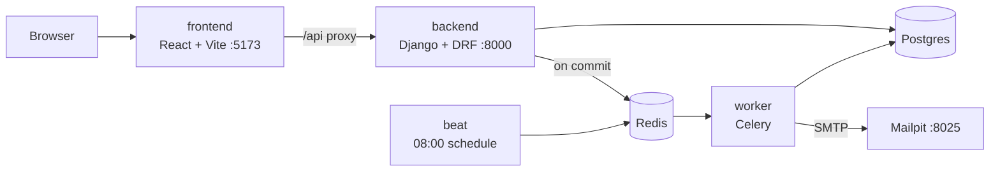
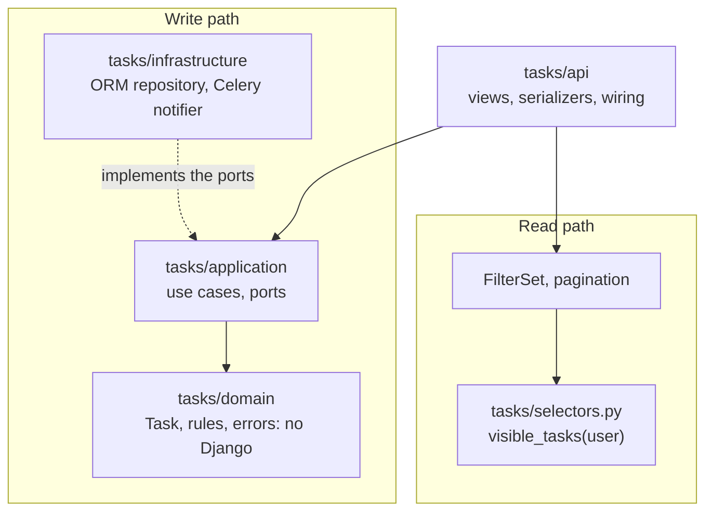

# ballast-lane-task

Team Task Board: a task management REST API built with Django REST Framework, with a React + TypeScript frontend. Built as a technical exercise for Ballast Lane.

**Reviewers, start here:** [PRESENTATION.md](PRESENTATION.md) is my thought process during the exercise, and [GENAI.md](GENAI.md) is how AI was used, validated and corrected.

Users sign in, create tasks, assign them to teammates, and move them through To do, In progress and Done. An assignee gets an email when a task is assigned to them, and a morning digest of their tasks due tomorrow. Admins see and manage every task.

## Run it with Docker

You need Docker (Docker Desktop on a Mac) and these host ports free:

| Port | Service |
|---|---|
| 5173 | The app (Vite, which proxies `/api` to the backend) |
| 8000 | The backend: the API, Swagger and the Django admin |
| 5433 | Postgres (set `POSTGRES_PORT` to change it) |
| 1025, 8025 | Mailpit: SMTP, and the web UI where the emails arrive |

If Mailpit is already running on your machine, for example from Homebrew, stop it first (`brew services stop mailpit`); `lsof -i :1025` shows what holds a port.

```bash
git clone https://github.com/aaronjae22/ballast-lane-task.git
cd ballast-lane-task
docker compose up --build --wait
```

No `.env` is needed: everything has a local default, and `.env.example` lists the overrides. The first build takes about 6 to 7 minutes; later starts take seconds. `--wait` returns once every service is healthy. The backend applies the migrations and seeds the demo data on startup.

Then open:
- http://localhost:5173: the app. Sign in with one of the accounts below.
- http://localhost:8000/api/docs/: Swagger UI. Get a token from `POST /api/auth/token/`, then paste it into **Authorize**.
- http://localhost:8000/admin/: the Django admin, as `admin`.
- http://localhost:8025: Mailpit. Assign a task to someone else and the email shows up here.

The due-tomorrow digest goes out at 08:00. To send it now:

```bash
docker compose exec worker celery -A config call tasks.send_due_tomorrow_reminders
```

Stop with `docker compose down`, or `docker compose down -v` to delete the database as well.

## Demo credentials

`seed_demo` creates these accounts and about 25 tasks across every status and due date. The local compose stack runs it on startup (`SEED_DEMO=true`). On a host, run `uv run python manage.py seed_demo` from `backend/`. It's idempotent: a second run creates nothing.

| Username | Role | Password |
|---|---|---|
| `admin` | Admin: sees and manages every task, and can use the Django admin | `demo-password` |
| `alice` | Team member | `demo-password` |
| `bob` | Team member | `demo-password` |
| `carol` | Team member | `demo-password` |

`demo-password` is for local use only. `SEED_DEMO_PASSWORD` replaces it, and any deployment other people can reach must set it, because the seed creates a superuser ([ADR 0015](docs/adr/0015-background-jobs-and-demo-data.md)).

## Run it on a host

Python 3.13 with [uv](https://docs.astral.sh/uv/), and Node 24 (pinned in `frontend/.nvmrc`). The quickest database is the compose one: `docker compose up -d db`, on host port 5433, which is the backend's default `DATABASE_URL`.

```bash
# Backend, from backend/
uv sync
DJANGO_DEBUG=true DJANGO_CACHE=locmem uv run python manage.py migrate
DJANGO_DEBUG=true DJANGO_CACHE=locmem uv run python manage.py seed_demo
DJANGO_DEBUG=true DJANGO_CACHE=locmem uv run python manage.py runserver

# Frontend, from frontend/, in another terminal
nvm use
npm ci
npm run dev    # http://localhost:5173, proxying /api to localhost:8000
```

`DJANGO_DEBUG=true` because with DEBUG off the settings refuse the built-in secret key. `DJANGO_CACHE=locmem` because the throttles need a cache and there's no Redis on the host. Emails and the reminder need Redis, Mailpit, a worker and Beat; [`AGENTS.md`](AGENTS.md#commands) has those commands.

## Tests and checks

```bash
# Backend, from backend/. The database tests need Postgres: docker compose up -d db
uv run pytest            # with the 80% coverage gate
uv run ruff check . && uv run ruff format --check .
uv run lint-imports      # the architecture contracts

# Frontend, from frontend/
npm test                 # Vitest
npm run lint && npm run typecheck
npm run e2e              # Playwright in Chromium; needs the database seeded and Redis, as runserver does
```

Tests never need Redis, a worker or an SMTP server: jobs run in-process and mail goes to Django's in-memory outbox.

CI runs on every pull request, in five jobs:
- `backend`: ruff, import-linter, pytest with the coverage gate.
- `frontend`: lint, type check, Vitest, production build.
- `api-contract`: the committed OpenAPI schema and TypeScript types must match the backend.
- `e2e`: the Playwright happy path, failing on any console warning or error.
- `docker`: builds the prod image, starts the compose stack and checks it end to end, from health and migrations to an email arriving in Mailpit and a login through the frontend's proxy.

## Architecture



The backend, the worker and Beat run from the same image. The frontend calls the API on its own origin, so the refresh-token cookie needs no CORS ([ADR 0006](docs/adr/0006-jwt-refresh-cookie-same-origin.md)).

Inside the backend, writes and reads take different paths ([ADR 0002](docs/adr/0002-architecture-strict-writes-plain-reads.md)):



- **Writes** go through use cases that apply the domain's rules, which are plain Python and tested without a database. The repository, the clock and the email notifier are ports, so the same use cases run against in-memory fakes in unit tests.
- **Reads** are ordinary Django querysets, all starting from `visible_tasks(user)`: an admin sees every task, anyone else the tasks they own or are assigned.
- **import-linter** keeps the layers apart in CI ([ADR 0011](docs/adr/0011-import-linter-contracts.md)).

## Key decisions

Each has a short record in [`docs/adr/`](docs/adr/):
- [Django + DRF](docs/adr/0001-backend-django-drf.md), with [strict layers on writes and plain Django on reads](docs/adr/0002-architecture-strict-writes-plain-reads.md).
- [Who can see and do what](docs/adr/0003-visibility-and-permissions.md): owners, assignees and admins.
- [Action endpoints](docs/adr/0004-action-endpoints.md) for status and assignment changes (`/start/`, `/complete/`, `/reopen/`, `/assign/`) instead of a writable `status` field.
- [JWT](docs/adr/0006-jwt-refresh-cookie-same-origin.md) with the access token in memory and the refresh token in an httpOnly cookie, one origin for the app and the API.
- [drf-spectacular instead of drf-yasg](docs/adr/0005-api-docs-drf-spectacular.md), which the brief names: drf-yasg only generates OpenAPI 2.0, and the frontend's types are generated from an OpenAPI 3 schema ([ADR 0016](docs/adr/0016-frontend-foundation.md)).
- [API conventions](docs/adr/0014-api-conventions.md): pagination, ordering, token lifetimes, strict input.
- [Celery](docs/adr/0015-background-jobs-and-demo-data.md) for the assignment email, queued after the commit, and the daily reminder.
- [React + TypeScript + Mantine](docs/adr/0007-frontend-react-typescript-mantine.md).
- [An AI workflow with a separate builder and reviewer](docs/adr/0010-ai-workflow-builder-reviewer.md).

## Repository layout

```text
backend/
  config/             settings, URLs, Celery app
  accounts/           custom User, auth endpoints, seed_demo
  tasks/
    domain/           Task and its rules (no Django)
    application/      use cases and ports
    infrastructure/   ORM repository, notifier, Celery jobs, emails
    api/              views, serializers, filters, wiring
    selectors.py      visible_tasks and the reminder's reads
  tests/              unit/, integration/, api/
frontend/
  src/api/            API client; generated/ holds the generated types
  src/auth/           session: login, silent refresh, logout
  src/features/       tasks and users: hooks, components, permissions
  src/routes/         pages
  e2e/                Playwright
GENAI.md              how AI was used, validated and corrected
PRESENTATION.md       my thought process during the exercise
docs/
  spec.md             user story, domain rules, architecture, API, iterations
  adr/                architecture decision records
  ai/prompts/         the prompt for each iteration
  query-plans.md      EXPLAIN on the list's filters
```

## Documentation

- [Specification](docs/spec.md): user story, domain rules, architecture, API, iterations
- [Architecture decision records](docs/adr/): why the main choices were made
- [PRESENTATION.md](PRESENTATION.md): my thought process, design choices and what I'd change
- [GENAI.md](GENAI.md): how AI was used, validated and corrected, and the [saved prompts](docs/ai/prompts/)
- [Query plans](docs/query-plans.md): how the list's filters use the indexes
- [AGENTS.md](AGENTS.md): instructions for coding agents working in this repo, and every command
